<div align="center">


# MiniCluster ML

**Turn the PCs in your lab into a single distributed machine-learning platform — controlled from a web browser.**


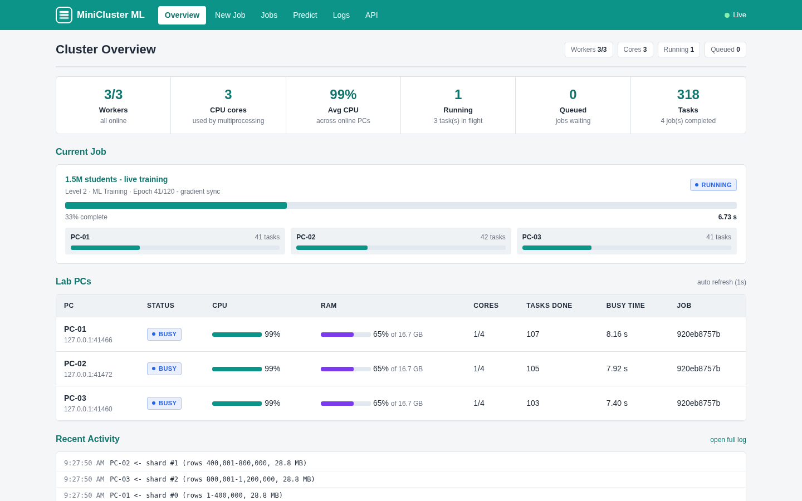

</div>

---

MiniCluster ML is a **parallel & distributed computing (P&DC) teaching platform**. A user submits an ML job in the
browser, the **coordinator** splits the data across the lab PCs, every **worker** PC computes its share on all of
its CPU cores, and the coordinator combines the results — all visible live on a dashboard.

It was built for a P&DC lab course, so every lab-manual topic appears in a real application:

| Lab topic | Where it appears in MiniCluster ML |
|---|---|
| **Socket programming** | coordinator ↔ worker communication over a custom framed TCP protocol |
| **Multithreading** | each worker runs receiver, heartbeat and executor threads on one socket |
| **Multiprocessing / OpenMP-style parallelism** | each PC splits its share across its CPU cores (process pool + shared memory) |
| **MPI-style distributed computing** | scatter → compute → reduce; broadcast weights → all-reduce gradients |
| **Performance analysis** | built-in speed-up / efficiency benchmark (Amdahl's law in practice) |
| **Fault tolerance** | unplug a PC mid-job — its work is reassigned automatically |

## Table of contents

- [Scenario](#scenario)
- [Features](#features)
- [Architecture](#architecture)
- [Quick start (one PC)](#quick-start-one-pc)
- [Running on 3 lab PCs](#running-on-3-lab-pcs)
- [Using the platform](#using-the-platform)
- [How distributed training works](#how-distributed-training-works)
- [Fault tolerance](#fault-tolerance)
- [REST API](#rest-api)
- [Configuration](#configuration)
- [Project structure](#project-structure)
- [Testing & quality](#testing--quality)
- [Documentation](#documentation)
- [Roadmap](#roadmap)
- [License](#license)

## Scenario

> **University "Smart Admission Predictor".** The university has 1,000,000 student records — matric marks,
> intermediate marks, entry-test score, attendance, previous GPA, weekly study hours and assignments
> submitted. It wants to predict whether a student will **pass or fail**. One computer is too slow, so the
> university turns three lab PCs into a team: each PC trains on a third of the records and the coordinator
> combines their work into one model.

```
                 WEB APPLICATION
                        │  "Train model"
                        ▼
                 ┌─────────────┐
                 │ Coordinator │
                 └──────┬──────┘
        ┌───────────────┼───────────────┐
        ▼               ▼               ▼
      PC-01           PC-02           PC-03
   333K records    333K records    334K records
        │               │               │
     gradients       gradients       gradients
        └───────────────┼───────────────┘
                        ▼
                 Combine (Σ / N)  →  Final model
```

A built-in generator produces this dataset at any size (1,000 to 5,000,000 rows) — identical on every run for
a given seed — so the lab works with no downloads. You can also upload your own CSV.

## Features

**Distributed computing**
- **Level 1 – Distributed compute:** square numbers, count primes, Monte Carlo π, with scatter / compute / reduce
- **Level 2 – Distributed ML:** linear, logistic and softmax regression trained data-parallel with
  **gradient sync** (parameter server, exact) or **model averaging** (local SGD / FedAvg)
- **Level 3 – Speed-up benchmark:** runs the same workload on 1…N PCs and plots speed-up & efficiency
- Two levels of parallelism: **across PCs** (TCP) and **inside each PC** (multiprocessing pool + shared memory)
- **Dynamic load balancing:** faster PCs pull more work; data shards stay on the same PC between epochs
- **Fault tolerance:** heartbeat failure detection, automatic task/shard reassignment, worker auto-reconnect

**Platform**
- Live web dashboard (WebSocket): per-PC CPU, per-core load, RAM, tasks, running job, event log
- Job queue with history in SQLite, cancel / re-run / delete, prediction with trained models
- REST API with OpenAPI docs, Prometheus `/metrics`, `/healthz`
- Security: cluster secret for workers, optional API token, strict input validation, no code over the wire
- Docker image + `docker compose` lab simulation, Windows `.bat` launchers, systemd example
- Dependency-free dashboard (no CDN, no build step) — works on an offline lab LAN
- 51 automated tests including real multi-process cluster tests with killed workers; CI on GitHub Actions

## Architecture

<p align="center">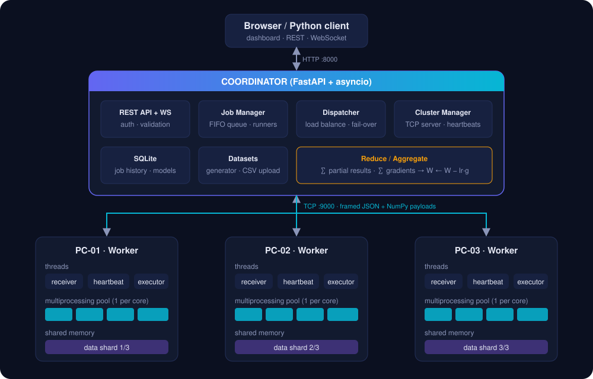</p>

| Layer | Technology |
|---|---|
| Frontend | HTML, CSS, vanilla JavaScript, SVG charts |
| Coordinator | Python, FastAPI, asyncio, SQLite |
| Communication | TCP sockets, length-prefixed JSON + binary NumPy payloads |
| Worker | Python threads, `multiprocessing.Pool`, `shared_memory`, psutil |
| ML engine | NumPy (linear / logistic / softmax regression) |

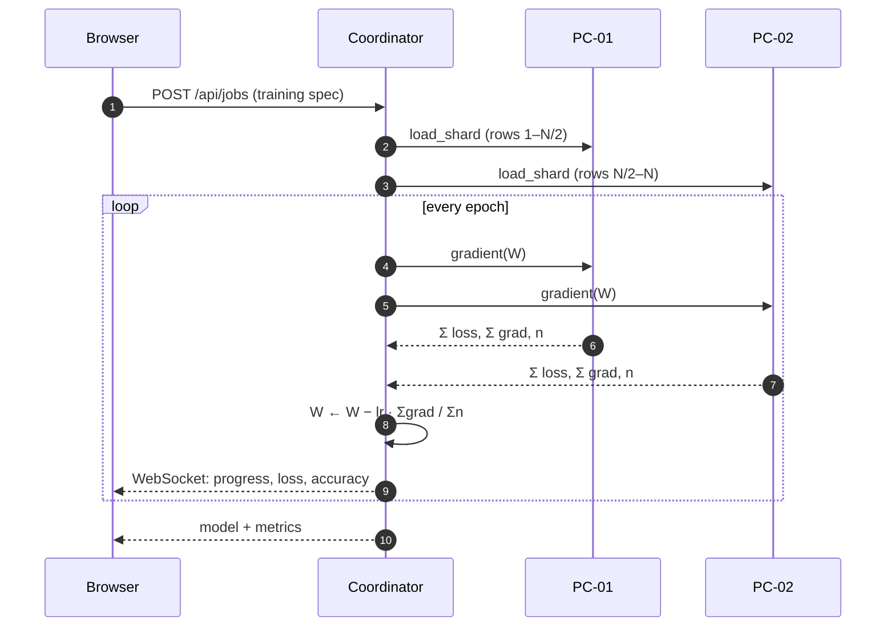

Details: [docs/ARCHITECTURE.md](docs/ARCHITECTURE.md).

## Quick start (one PC)

Requirements: **Python 3.10+** (Windows, Linux or macOS).

```bash
git clone https://github.com/<your-username>/minicluster-ml.git
cd minicluster-ml
python -m venv .venv
source .venv/bin/activate            # Windows: .venv\Scripts\activate
pip install -r requirements.txt

./scripts/run_local_cluster.sh       # coordinator + 3 workers on this machine
```

Open **http://localhost:8000**. On Windows, run these in three or four terminals instead:

```bat
python -m minicluster.coordinator
python -m minicluster.worker --name PC-01 --cores 1
python -m minicluster.worker --name PC-02 --cores 1
python -m minicluster.worker --name PC-03 --cores 1
```

Or with Docker:

```bash
docker compose up --build            # http://localhost:8000
```

## Running on 3 lab PCs

```
Coordinator  192.168.1.10   ── ports 8000 (web) + 9000 (workers)
PC-01        192.168.1.11 ─┐
PC-02        192.168.1.12 ─┼── same LAN / switch
PC-03        192.168.1.13 ─┘
```

1. Install the project on every PC (see above).
2. On the coordinator PC:
   ```bash
   python -m minicluster.coordinator          # Windows: scripts\start_coordinator.bat
   ```
   Allow TCP ports **8000** and **9000** through the firewall.
3. On each lab PC:
   ```bash
   python -m minicluster.worker --coordinator 192.168.1.10 --name PC-01
   # Windows: scripts\start_worker.bat 192.168.1.10 PC-01
   ```
4. Open `http://192.168.1.10:8000` from any browser in the lab. The PCs appear as **ONLINE** within a second.

Recommended in a shared network: start the coordinator with `MINICLUSTER_CLUSTER_SECRET=<secret>` and the
workers with `--secret <secret>`. The full step-by-step guide with eight lab exercises is in
**[docs/LAB_GUIDE.md](docs/LAB_GUIDE.md)**.

## Using the platform

### 1. Cluster overview
Live status of every PC: CPU, per-core load, RAM, task counters and the job each PC is working on, plus the
active job's per-worker progress and a live event log.


### 2. Submit a job — three levels

| Level 1 · Distributed compute | Level 2 · Distributed ML training |
|---|---|
| 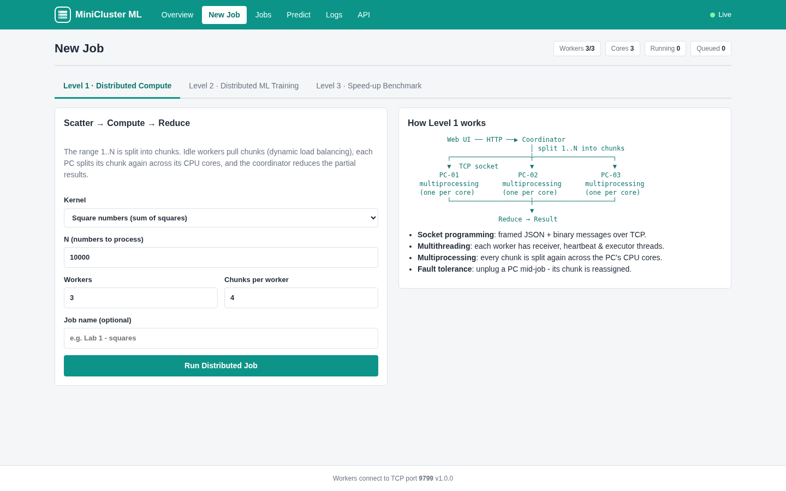 | 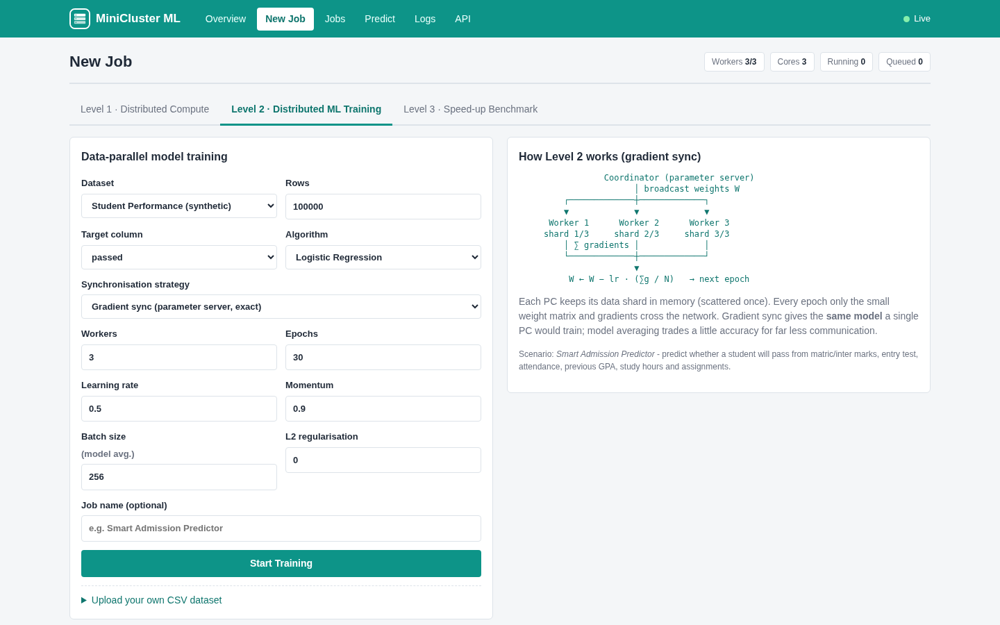 |

### 3. Level 1 result — scatter, compute, reduce
The range 1…N is split into chunks; idle PCs pull chunks (dynamic load balancing) and the coordinator reduces the
partial results. Here: all 148,933 primes below 2,000,000, found by three PCs.

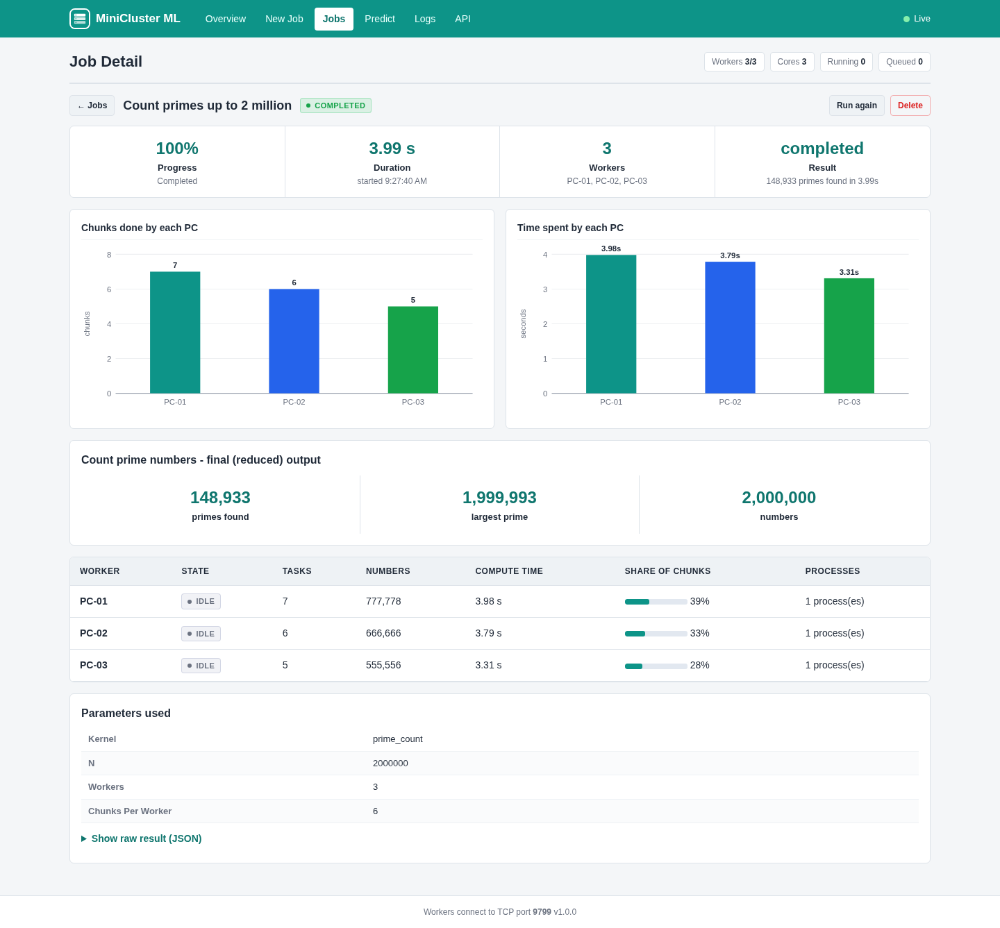

### 4. Level 2 result — distributed training
Loss and accuracy per epoch, a breakdown of where the time went (data scatter, worker compute, communication,
coordinator), and per-PC statistics.

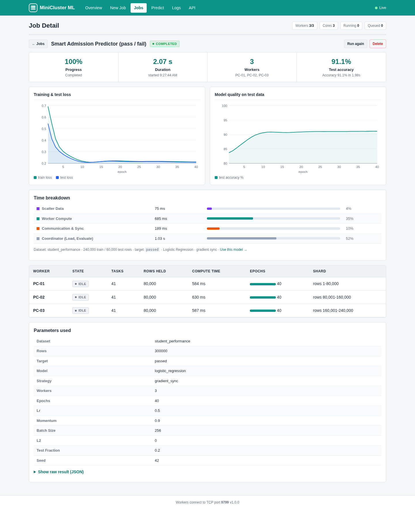

### 5. Level 3 — speed-up & efficiency
`Speedup(p) = T(1) / T(p)` and `Efficiency(p) = Speedup(p) / p`, plotted against the ideal linear speed-up.

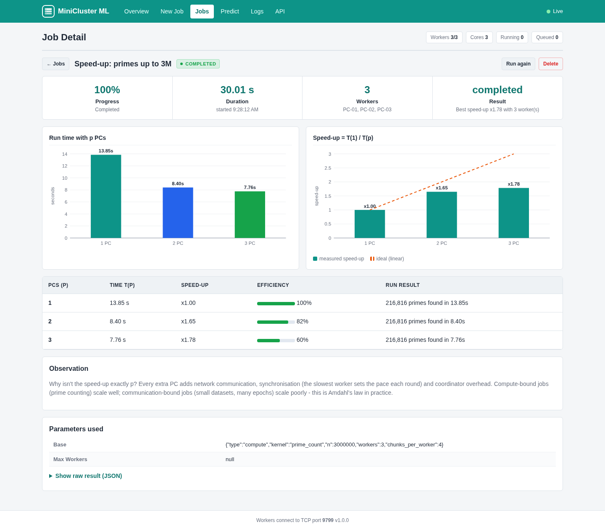

> **About these numbers:** the screenshots were captured on a single laptop with **2 physical cores**
> simulating three PCs, so the speed-up cannot exceed ~2×. On three real lab PCs a compute-bound job like
> prime counting scales close to 3×. *"Why isn't it exactly 3×?"* is the discussion the benchmark is designed
> to start: communication, synchronisation, load imbalance and the serial part of the program.

### 6. Use the trained model

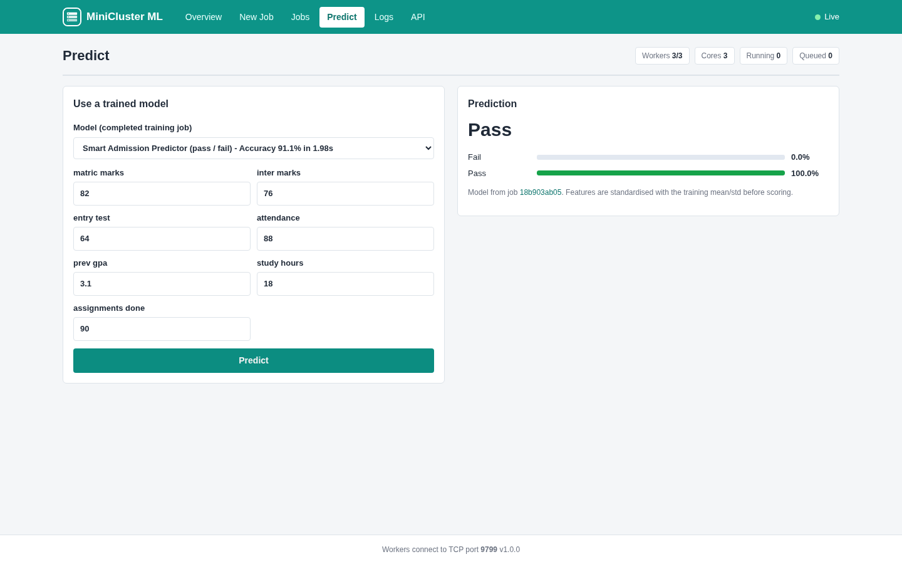

### 7. Responsive & API docs

| Mobile | OpenAPI / Swagger (`/docs`) |
|---|---|
| 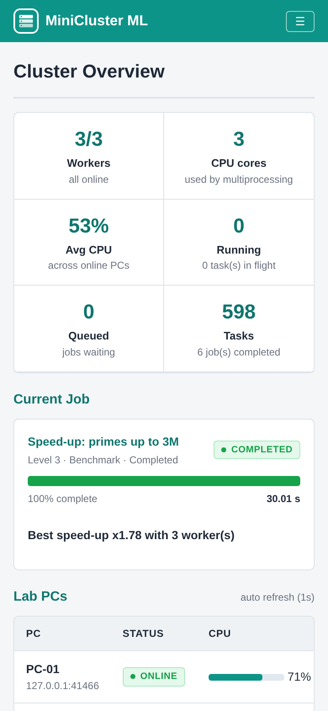 | 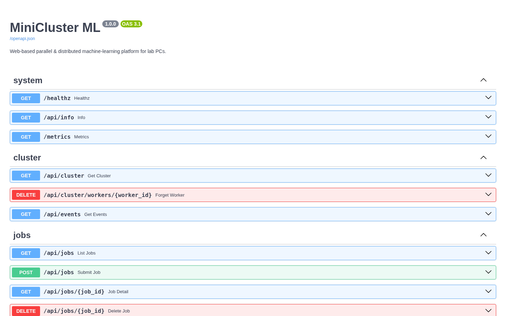 |

## How distributed training works

Each worker holds a shard `S_k` of the training data in memory (sent once). Every epoch the coordinator
broadcasts the weights `W`; each worker returns the **sum** of its gradients and its row count:

```
g = (g_1 + g_2 + g_3) / (n_1 + n_2 + n_3)        exact full-dataset gradient
W ← W − lr · g                                    (with momentum)
```

Because sums are associative, **gradient sync trains exactly the same model on 1, 2 or 3 PCs** — a property
checked by the test suite. It answers the classic question *"isn't training three separate models on three
pieces of data different from one model on all of it?"* — yes, which is why the PCs synchronise every epoch.

**Model averaging** trades this exactness for less communication: each PC runs a full epoch of mini-batch SGD
locally and the coordinator averages the weights. Try both and compare accuracy and time.

## Fault tolerance

Kill a worker (or pull its network cable) while a job runs. The coordinator detects the missing heartbeats,
re-queues the lost chunk or shard, and another PC takes over — the job still completes with the correct result.

| Live: PC-03 goes offline | The job completes; PC-01 took over PC-03's shard |
|---|---|
| 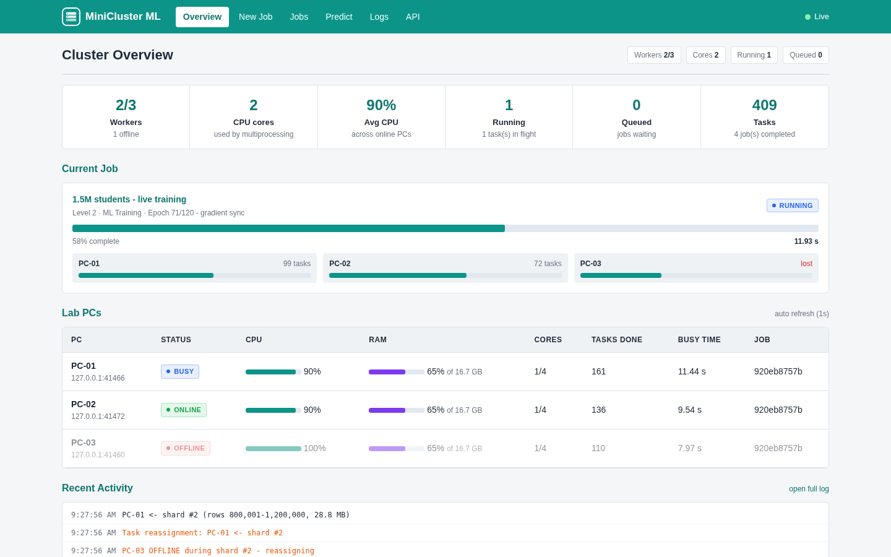 | 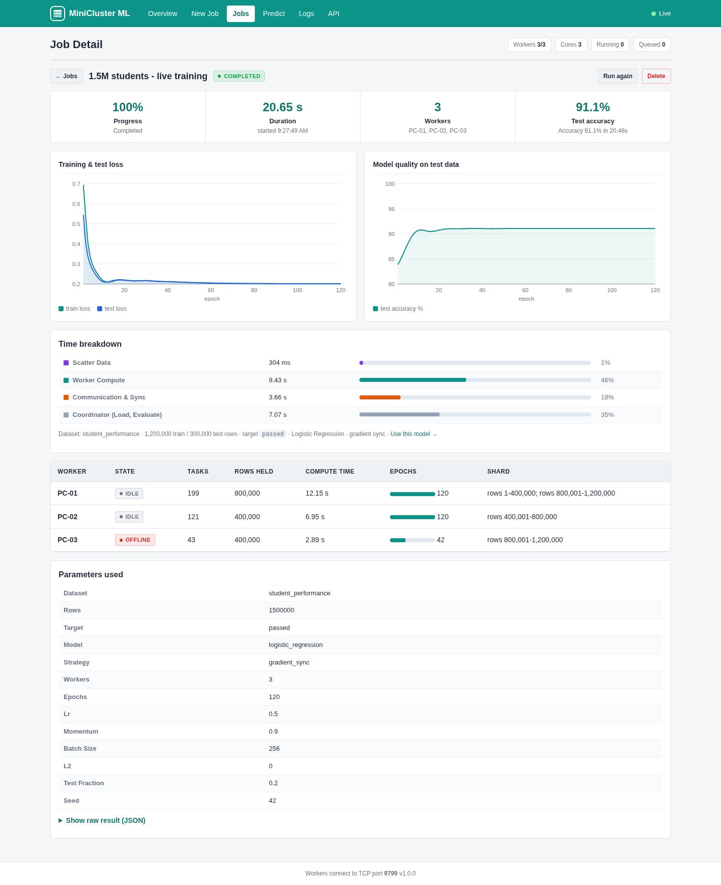 |

```
PC-03 OFFLINE (connection closed) - 1 in-flight task(s) will be reassigned
PC-03 OFFLINE during shard #2 - reassigning
Task reassignment: PC-01 <- shard #2
PC-01 <- shard #2 (rows 800,001-1,200,000, 28.8 MB)
Training finished: Accuracy 91.1%
```

## REST API

Everything the dashboard does is available over HTTP. Interactive docs: `http://<coordinator>:8000/docs`.

```bash
# submit a training job
curl -X POST http://localhost:8000/api/jobs -H 'Content-Type: application/json' -d '{
  "name": "Smart Admission Predictor",
  "spec": {"type": "training", "rows": 300000, "target": "passed",
           "model": "logistic_regression", "workers": 3, "epochs": 30}
}'

# poll it
curl http://localhost:8000/api/jobs/<job-id>

# predict with the trained model
curl -X POST http://localhost:8000/api/jobs/<job-id>/predict -H 'Content-Type: application/json' \
  -d '{"rows":[{"matric_marks":82,"inter_marks":76,"entry_test":64,"attendance":88,
               "prev_gpa":3.1,"study_hours":18,"assignments_done":90}]}'
```

Full reference: [docs/API.md](docs/API.md). A dependency-free Python client is in
[scripts/client_example.py](scripts/client_example.py).

## Configuration

| Variable | Default | Description |
|---|---|---|
| `MINICLUSTER_HTTP_PORT` | `8000` | dashboard + API port |
| `MINICLUSTER_WORKER_PORT` | `9000` | TCP port for workers |
| `MINICLUSTER_DATA_DIR` | `./data` | job history (SQLite) and uploaded CSVs |
| `MINICLUSTER_CLUSTER_SECRET` | — | shared secret workers must present |
| `MINICLUSTER_API_TOKEN` | — | bearer token required for the API and dashboard data |
| `MINICLUSTER_HEARTBEAT_TIMEOUT` | `6` | seconds before a silent worker is declared offline |
| `MINICLUSTER_MAX_CONCURRENT_JOBS` | `1` | jobs run at the same time |

All options, systemd units, TLS reverse proxy and Prometheus setup: [docs/DEPLOYMENT.md](docs/DEPLOYMENT.md).

Worker flags: `--coordinator HOST`, `--port`, `--name PC-01`, `--cores N`, `--secret`, `--slowdown X`
(simulate a slower PC), `--no-reconnect`.

## Project structure

```
minicluster-ml/
├── minicluster/
│   ├── common/
│   │   ├── protocol.py        # TCP framing, NumPy payload packing
│   │   ├── ml.py              # linear / logistic / softmax regression (NumPy)
│   │   ├── compute.py         # Level-1 kernels: squares, primes, Monte Carlo π
│   │   └── datasets.py        # Student Performance generator, CSV loader
│   ├── coordinator/
│   │   ├── app.py             # FastAPI: REST, WebSocket, metrics, dashboard
│   │   ├── cluster.py         # asyncio TCP server, registration, heartbeats, remote calls
│   │   ├── schemas.py         # pydantic request validation
│   │   ├── store.py           # SQLite job history
│   │   ├── datasets.py        # dataset catalogue + uploads
│   │   ├── config.py          # MINICLUSTER_* settings
│   │   └── jobs/
│   │       ├── base.py        # Job model + Dispatcher (load balancing, fail-over)
│   │       ├── compute.py     # Level 1
│   │       ├── training.py    # Level 2 (gradient sync / model averaging)
│   │       ├── benchmark.py   # Level 3
│   │       └── manager.py     # job queue & lifecycle
│   ├── worker/
│   │   └── node.py            # sockets + threads + multiprocessing + shared memory
│   └── web/                   # dashboard (HTML/CSS/JS, no build step)
├── tests/                     # 51 unit, API and multi-process integration tests
├── scripts/                   # local cluster, Windows launchers, dataset export, client, screenshots
├── docs/                      # architecture, lab guide, API, deployment, images
├── Dockerfile · docker-compose.yml · Makefile · pyproject.toml
└── .github/workflows/ci.yml   # lint + tests (3.10–3.12) + Docker smoke test
```

## Testing & quality

```bash
pip install -r requirements-dev.txt
pytest -q                 # 51 tests, ~40 s
ruff check minicluster tests scripts
```

The suite includes:
- finite-difference gradient checks for all three models;
- proof that sharded gradient sums equal the full gradient for 1, 2, 3 and 7 shards;
- protocol tests (framing, oversized frames, asyncio ↔ blocking-socket interoperability);
- API tests (validation, auth, uploads with path-traversal names, cancellation);
- **real cluster tests** that start a coordinator and worker processes, kill workers mid-job and check that
  results are still exact (e.g. π(1,500,000) = 114,155), that 1 PC and 3 PCs produce identical models, and
  that a worker with the wrong secret is rejected.

## Documentation

| Document | Contents |
|---|---|
| [docs/LAB_GUIDE.md](docs/LAB_GUIDE.md) | 3-PC lab setup, teaching scenario, 8 lab exercises with report questions, MPI mapping |
| [docs/ARCHITECTURE.md](docs/ARCHITECTURE.md) | components, protocol, concurrency model, dispatcher, training maths, security |
| [docs/API.md](docs/API.md) | REST & WebSocket reference with examples |
| [docs/DEPLOYMENT.md](docs/DEPLOYMENT.md) | configuration, Docker, systemd, TLS, monitoring, backup, troubleshooting |
| [CONTRIBUTING.md](CONTRIBUTING.md) · [SECURITY.md](SECURITY.md) · [CHANGELOG.md](CHANGELOG.md) | project policies |

## Roadmap

- `mpi4py` back-end (`MPI_Allreduce`) to compare with the socket implementation
- GPU workers (PyTorch/CUDA) for small neural networks
- Mini-batch synchronous SGD and asynchronous parameter server
- Random-forest training with tree-level parallelism
- Per-user accounts and job quotas

## License

[MIT](LICENSE) — free to use for teaching and research.
