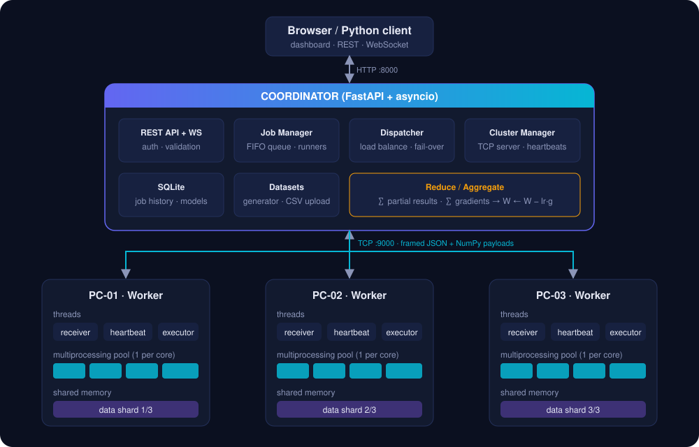
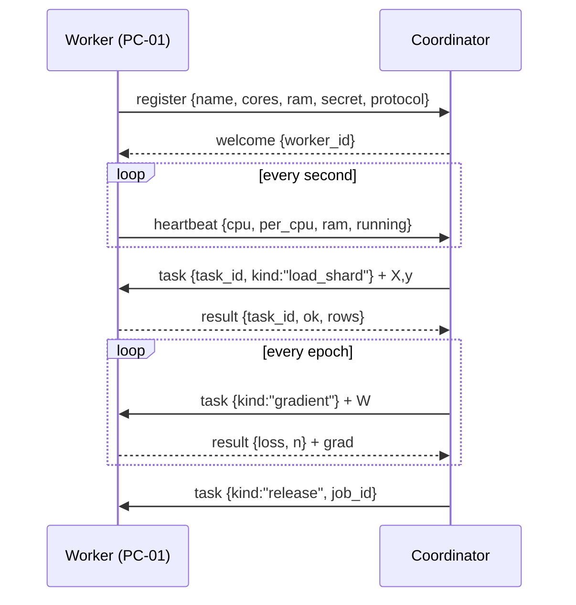

# Architecture

This document explains how MiniCluster ML is put together and why. It is
written for developers extending the system and for instructors who want to
walk students through the code.



## 1. Components

| Component | Code | Responsibility |
|---|---|---|
| **Web dashboard** | `minicluster/web/` | Vanilla HTML/CSS/JS single-page app. No build step, no CDN — works on an offline lab LAN. Receives live state over a WebSocket. |
| **REST API + WebSocket** | `coordinator/app.py`, `coordinator/schemas.py` | FastAPI app. Validates job specs with pydantic, enforces the optional API token, serves the dashboard, `/metrics` and `/healthz`. |
| **Job Manager** | `coordinator/jobs/manager.py` | FIFO queue of jobs, `MAX_CONCURRENT_JOBS` runner tasks, status transitions, persistence to SQLite. |
| **Job runners** | `coordinator/jobs/compute.py`, `training.py`, `benchmark.py` | The three levels of the lab: scatter/compute/reduce, data-parallel training, speed-up experiments. |
| **Dispatcher** | `coordinator/jobs/base.py` | Runs a list of items on a pool of workers with dynamic load balancing, data affinity and automatic fail-over. Shared by every job type. |
| **Cluster Manager** | `coordinator/cluster.py` | asyncio TCP server. Registers workers, checks the cluster secret, tracks heartbeats, turns every remote task into an `asyncio.Future`. |
| **Store** | `coordinator/store.py` | SQLite (WAL mode) job history, including trained model weights. |
| **Worker** | `worker/node.py` | Runs on every lab PC. Socket + threads + multiprocessing pool + shared memory. Executes compute kernels and ML gradient / local-SGD steps. |
| **Shared code** | `common/protocol.py`, `common/ml.py`, `common/compute.py`, `common/datasets.py` | Wire protocol, NumPy ML engine, CPU kernels, dataset generator / CSV loader. |

## 2. Wire protocol

Coordinator and workers talk over **one persistent TCP connection per worker**.
Every message is a frame:

```
+----------------+-----------------+----------------+-----------------+
| header_len (4) | payload_len (8) | header (JSON)  | payload (bytes) |
+----------------+-----------------+----------------+-----------------+
```

* The JSON header always has a `type`: `register`, `welcome`, `reject`,
  `heartbeat`, `task`, `result`, `shutdown`.
* The optional binary payload carries NumPy arrays packed with `np.savez`
  (data shards, weight matrices, gradients) so large arrays never go through
  JSON.
* Frames above 16 MB header / 4 GB payload are rejected (`ProtocolError`).



## 3. Concurrency model

### Coordinator — single asyncio event loop
* `asyncio.start_server` accepts worker sockets; one reader coroutine per
  worker dispatches `result` frames to the matching `Future`.
* A monitor coroutine marks a worker **offline** if no frame arrived within
  `HEARTBEAT_TIMEOUT` seconds, and broadcasts a cluster snapshot every second.
* CPU-heavy coordinator work (dataset generation, `np.savez`) runs in
  `asyncio.to_thread` so the API stays responsive.

### Worker — threads + processes
| Thread / process | Purpose |
|---|---|
| main thread | connect, register, reconnect with exponential back-off, receive loop |
| heartbeat thread | sends CPU / RAM / per-core load every second |
| executor thread | pops tasks from a `queue.Queue`, runs them, sends results |
| `multiprocessing.Pool` (one process per `--cores`) | splits a chunk or shard further across CPU cores |

Socket sends from several threads are serialised with a `threading.Lock`.
Training shards are copied **once** into `multiprocessing.shared_memory`, and
pool processes attach to them by name, so per-epoch tasks only ship the small
weight matrix to the processes. BLAS is pinned to one thread per process so
`--cores` is the only source of parallelism (honest speed-up numbers).

## 4. The Dispatcher (load balancing + fault tolerance)

`Dispatcher.map(items, fn)` is the heart of the system:

1. **Pull-based scheduling.** Each idle worker takes the next pending item.
   Fast PCs automatically process more chunks — try `--slowdown 3` on one
   worker and watch the "chunks per worker" chart.
2. **Affinity.** Items may have a *home* worker (the PC that already holds a
   data shard). A worker prefers its own items and only takes orphans, so data
   is not re-sent every epoch.
3. **Fail-over.** If a worker disconnects or misses heartbeats, every pending
   `Future` on it fails with `WorkerLost`. The dispatcher puts the item back
   at the front of the queue, logs `PC-02 OFFLINE … reassigning`, and the next
   idle worker picks it up (`Task reassignment: PC-01 <- shard #2`). For
   training, the new owner first receives the shard, then computes.
4. **Recruiting.** If the pool shrinks below the requested size, idle online
   workers (including a PC that reconnected) are recruited automatically.
5. **Errors vs. failures.** A task that *raises* on the worker (`TaskFailed`)
   is a bug in the job, not a hardware problem — the job fails fast instead
   of retrying forever.

## 5. Distributed training maths

Let the training set be split into shards `S_1 … S_p`. Each worker returns
the **sum** of its loss and gradient plus its row count:

```
g_k = Σ_{i∈S_k} ∇ℓ(w; x_i, y_i)        n_k = |S_k|
g   = (Σ_k g_k) / (Σ_k n_k)            (exact full-batch gradient)
v   ← μ·v − η·(g + λw)                 (momentum)
w   ← w + v
```

Because sums are associative, **gradient sync produces exactly the same
model regardless of how many PCs are used** — this is verified by
`tests/test_integration.py::test_gradient_sync_is_independent_of_worker_count`.

**Model averaging** (local SGD / FedAvg) instead lets each worker run a full
epoch of mini-batch SGD on its shard and averages the weights:
`w ← Σ_k n_k·w_k / Σ_k n_k`. Communication drops to one round-trip per epoch
but the result is only an approximation of centralised SGD — a good
discussion point.

Supported models (all linear, NumPy only):

| Model | Task | Output |
|---|---|---|
| Linear regression | regression | MSE loss, RMSE + R² metrics |
| Logistic regression | binary classification | cross-entropy, accuracy |
| Softmax regression | multi-class classification | cross-entropy, accuracy |

Features are standardised with the training-set mean/std; the scaler is
stored with the model and re-applied by `POST /api/jobs/{id}/predict`.

## 6. Timing breakdown

Every training job reports where the time went:

| Bucket | Meaning |
|---|---|
| `scatter` | sending data shards to the workers (once) |
| `compute` | Σ over epochs of the **slowest** worker's compute time |
| `communication` | Σ over epochs of (round time − slowest compute) = network + serialisation + waiting |
| other | dataset generation, coordinator-side evaluation |

This makes Amdahl's law visible: adding PCs shrinks `compute` but not the
other buckets.

## 7. State & persistence

* Jobs (spec, status, per-worker stats, history, result incl. weights) are
  written to `DATA_DIR/minicluster.db` at every status change.
* On restart, jobs that were `queued`/`running` are marked
  `failed: interrupted: coordinator restarted`.
* Workers keep running when the coordinator restarts and reconnect
  automatically.
* Uploaded CSVs live in `DATA_DIR/uploads/` (file names are sanitised).

## 8. Security model

MiniCluster ML is designed for a trusted lab LAN, with these safeguards:

* **Cluster secret** (`MINICLUSTER_CLUSTER_SECRET`): workers must present it
  to register (constant-time comparison). Prevents random machines joining.
* **API token** (`MINICLUSTER_API_TOKEN`): if set, every `/api/*`,
  `/metrics` and the WebSocket require `Authorization: Bearer <token>`.
* Workers only execute a **fixed set of task kinds** (`compute`,
  `load_shard`, `gradient`, `local_train`, `release`, `ping`) — no arbitrary
  code or pickle is ever sent over the network (`np.load(allow_pickle=False)`).
* Input validation on every job field (ranges, enums), upload size limit,
  path-traversal-safe upload names.
* Docker image runs as a non-root user.

Traffic is not encrypted; run behind a reverse proxy with TLS (see
[DEPLOYMENT.md](DEPLOYMENT.md)) if the network is not trusted.

## 9. Extending

* **New compute kernel** — add a function `(start, end) -> dict` to
  `common/compute.py`, register it in `KERNELS`, handle it in
  `reduce_results`, and add it to the `Literal` in `schemas.ComputeSpec`.
* **New model** — implement it in `common/ml.py` (`forward`,
  `loss_and_grad_sum`, `predict`, `evaluate`) and add it to `MODELS`.
* **New job type** — write `async def run_x(ctx, spec)` using `Dispatcher`
  and register it in `RUNNERS` in `jobs/manager.py`.
